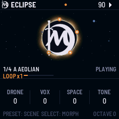

# Penumbra

**An ambient space-drone synth that plays itself until you do.** For the M-VAVE FM-1, by Lunar Eclipse Forge.

Drone voices drift in and out, a far-off voice sings, and the sound glides from scene to scene as an eclipse
crosses the screen. Every key is in tune, and loops follow each key change. A thick, slow drone, like the
Solar 42.

Most drones stay where they are put. Penumbra is a place, and it moves. It is played less like a keyboard
and more like a mixing desk in a night sky: shaping, throwing and steering a sound that is already playing.

- **It plays itself, until it is played.** A new unit starts on TOTALITY, a journey that travels on its
  own: scene after scene, its whole sound changing as it goes, a voice singing now and then.
- **The sound is the instrument.** HOME's four knobs play six pages, one turn of ALGO apart: the drone's
  filter, body, swarm and wave; VOX's tone; the drone's slow motion and the tides; the space; the mix; and
  how much plays by itself.
- **Gestures, not just settings.** FX held turns the knobs into throws: a burst of shimmer, feedback, a
  frozen room, the whole mix dipped, drifting back when let go. A held key puts that voice under the knobs.
  A slow walk between two versions of the whole sound.
- **It travels.** One click of a knob and the whole place glides to a new scene over 12 seconds: the drone
  voice by voice, the room, the key. Or SELECT walks there by hand, as slowly as it is turned. Seven journeys
  are built in, and there's room for eight more.
- **Nothing sounds wrong.** Every white key is in the scene's key, and so is everything it plays itself.
  Loops are kept as steps of the key, so they follow into each new scene.
- **The eclipse shows it.** On the screen the moon slides off the sun as a scene changes, the drone's voices
  swell as beads in the corona, notes come out as stars, and the loop circles as a satellite. Behind every
  other page a moon rises in that page's colour, breathing with the tide.

The silence between the notes is part of it.

Version 1.13 · identity `FM-1_73011300` · GPL-3.0

**[Play it in the browser](https://madmooneyham.github.io/Penumbra/emu/)** (the same code the FM-1 runs) ·
**[Cheat sheet](https://madmooneyham.github.io/Penumbra/cheatsheet/)** (one printable page)

## The first few minutes

Penumbra is slow, and much of what it does best unfolds over a few minutes.

- **On its own,** TOTALITY, the journey a new unit starts on, plays by itself: the drone's voices drift in
  and out, HALO sings a phrase now and then, and every 16 bars it glides to its next scene, six in all, the
  sound opening up toward the middle and closing again. Everything below works while it does.
- **HOME's knobs** shape it as it plays. The first page is the drone: FILTER, BODY, SWARM, WAVE. **ALGO** on
  HOME turns to the next page: VOX, MOTION (the drone's sweep and drift, the tides), SPACE, MIX and ALIVE
  (how often it sings and blooms, how many drone voices come and go, how often it travels).
- **Throws:** with **FX** held, **K1** sends a burst of shimmer, **K3** freezes the room, **K4** dips the
  whole mix; let go, they drift back.
- **A voice in hand:** a drone key (black 1-5) held puts that voice's level, tone, detune and octave under
  the knobs; pressed, it calls the voice in, to swell and fade.
- **Travelling:** one click of **PRESET** moves to the next scene. Over 12 seconds the drone glides there
  voice by voice, the room changes, and a loop carries on in the new key. On HOME, **SELECT** walks there by
  hand instead, as slowly as it is turned.
- **The keys:** the white keys play VOX, every key in the scene's key; slow, spacious playing suits it.
  **REC**, a few notes, **REC** again, and they loop on the clock.

## More it can do

- **ECLIPSE** (LFO opens the journeys) is the quiet one: all five drone voices come and go, and nothing else
  moves until it is shaped or played.
- **A frozen chord:** notes held when **ARP** is pressed keep ringing; **ARP** again lets them go.
- **Bends:** a white key held puts its note's brightness, vibrato, shimmer and release under the knobs, and
  **ALGO** bends its pitch.
- **Held voices:** a drone key held with **ALGO** turned left makes that voice HELD, on until its key is
  pressed again. In the other journeys most voices start held.
- **Voices that sing:** one of VOX's sound keys (black 8-11) held with **ALGO** turned right sets that
  sound singing by itself, rarely or often. Each sound has its own setting, so several can sing at once
  while the white keys play another, each with its own place, drift and octave on SHAPE's VOX SINGS page.
- **BLOOM by itself:** BLOOM's key (black 7) held with **ALGO** turned right sets it swelling in now and
  then on its own.
- **The kick:** its key (black 6) held puts its drop, decay, click and TUNE (root, fourth, fifth, octave) under
  the knobs, and **ALGO** sets it playing by itself: a heartbeat, every bar, every half bar or every two.
  SHAPE's PULSE 2 adds DRIVE and DUCK, each kick dipping the drone and letting it swell back, and SCENE's
  LANDS drops a kick as each new key comes in.
- **Layers of instruments:** each looped note keeps the VOX sound it was played with, so a layer of GLASS,
  one of REED and one of HALO play together.
- **The loop's layers:** **SEL** pressed on HOME opens LOOP, where each layer has its own level, sound,
  octave and mute, and (**ENV** there) its own place in the field, a drift round it on the tide, a tone
  and a swell. **ALGO** gives a layer its own length, so layers drift out of step like tape loops. Any
  layer can be taken out, and on HOME each layer is a bead on the orbit at its place.
- **Colour:** black key 7 is BLOOM, a slow swell; black keys 8-11 are VOX's four sounds.
- **Other journeys:** **LFO** opens JOURNEY, **SELECT** moves through it, and **SEL** opens one. Each brings
  its own sound, gliding in: FAR SIDE is vast, PERIGEE close and quick, TRANQUILITY still. A knob turned
  right there locks the sound playing, so only the scenes change.
- **Two sounds:** with **ENV** held, **OCT-** keeps the sound as A and **OCT+** as B, and **SELECT** walks
  between them.
- **SLEEP** (in SYSTEM, the **GLO** button) lets everything go over 20 to 90 minutes.
- **Holding any button** for a moment shows on the screen what it does.

## Install

- **The easy way:** install it in one click from [The Firmware Hub](https://thefirmwarehub.com/).
- **In the browser:** the [web installer](https://madmooneyham.github.io/Penumbra/install/) writes it over USB
  (Chrome or Edge).
- **By hand:** download `penumbra-1.13.fwsc` from this repository's
  [Releases](https://github.com/MadMooneyham/Penumbra/releases), and write it with an FM-1 firmware installer.

Penumbra carries the update loader, so you can always go back to another firmware or to M-VAVE's own. If an
install ever won't start, hold **OCT-** and **OCT+** for five seconds to put the FM-1 in update mode.

**Backups:** the [Backup page](https://madmooneyham.github.io/Penumbra/backup/) (Chrome or Edge) copies the user
journeys, the sound library, the journey playing, the loop and the settings to one file, and puts any of them
back, onto this FM-1 or another. The emulator reads and writes the same file.

**Journeys of one's own:** SCENES (EDIT twice) shows the whole journey, a scene a row, to reorder, skip, time and
bring in scenes from any journey. The [Journeys page](https://madmooneyham.github.io/Penumbra/journey/) (Chrome
or Edge) does the same at a desk and sends the journey to a user slot, or to play now, with no restart.

## The manual

Everything else, from HOME's pages and the gestures to the scenes, the loop, the keys and every sound
setting, is in the **[manual](MANUAL.md)**. Its last section is a one-page cheat sheet.

## What's in it

- **DRONE**: five voices on black keys 1-5, each held or coming and going, with a SWARM that thickens them.
- **VOX**: an eight-voice synth on the white keys. It has four sounds (GLASS, REED, HALO, LOW), a wave from saw
  to a narrow pulse, a filter from low-pass to band-pass, and glide.
- **PULSE**: a deep kick tuned to the key, and BLOOM.
- **TEXTURE**: a bed of space wind, always under the rest.
- **Movement**: TIDES, one slow swell under it all (8 seconds to 4 minutes a tide) through the drone, the space
  and VOX; the drone's own drift and sweep; PAN, each part's place in the field, swaying as far as you like, on the
  tide or at a rate of its own, together or one after another.
- **Effects**: a shimmer reverb (an octave, a fifth or a twelfth up), a worn ping-pong tape delay you can
  WARP, a filter that dips both ways, and a master stage. Each scene has its own room, gliding with it.
- **The sound, kept**: A/B (two versions of the sound, a blend between them) and a library of eight sounds
  you can bring into any journey.
- **Journeys**: seven preset banks of scenes, and eight user slots. Any of them can travel by itself, every 8 to 64
  bars, and each scene can name where the sound sits between A and B. The journey playing, with its loop and its
  A/B, survives a power cut.
- **With a DAW**: USB audio and MIDI. A tight clock in (and song position) or out, VOX's notes and the black
  keys both ways, 66 controls on CCs both ways (automate them, or record your moves), and KNOBS: CONTROLLER, the knobs as a MIDI controller, program changes for the
  scenes and journeys.
- **Extras**: a SLEEP timer, USB ONLY (the FM-1's own outputs silent while a computer takes its USB audio),
  backups, and screen-reader support.

## Tell me how you play it

Penumbra grows from how people use it. I'd love to hear:

- what you play with it, and what it makes you want to do next;
- what felt unclear, or got in your way;
- anything that sounds or behaves wrong.

**[Open an issue](https://github.com/MadMooneyham/Penumbra/issues/new/choose)** and pick "Something is wrong"
or "An idea". For a problem, the steps you took matter most: the journey, the page, what you held and
turned. Most problems can be replayed in Penumbra's simulator from those steps alone.

To share a journey or a sound, ask how something works, or talk about how you play it, use
**[Discussions](https://github.com/MadMooneyham/Penumbra/discussions)**.

## For developers

Penumbra is written in C for the FM-1's JieLi AC791N. Its audio engine runs on both cores, and the whole app
also runs on a desktop simulator for testing.

- **Building:** BUILDING.md covers the toolchain, `./build.sh --release X.Y`, and the web installer.
  - Release builds are `FM-1_73XXYYZZ`; development builds are `FM-1_730`.
- **Tests:** `tests/run_tests.sh` runs the unit tests, the simulator's scenarios (`tests/scenarios/*.pen`)
  and the click checks.
- **Where things are:**
  - `firmware/src/dsp/`: the voices;
  - `firmware/src/seq/`: the journeys and the looper;
  - `firmware/src/app/`: the engine, the UI and the settings;
  - `host/`: the simulator.
- **Licence:** GPL-3.0-only. Penumbra is built on [Felucca](https://github.com/hugelton/Felucca) (Leo
  Kuroshita, Hügelton Instruments) and [X0X](https://github.com/charlesvestal/fm1-x0x) (Charles Vestal). The
  full credits are in LICENSING.md.

M-VAVE and FM-1 are trademarks of their owners.
