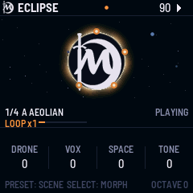

# Penumbra

**A space-drone instrument for the M-VAVE FM-1**, by Lunar Eclipse Forge.

Switched on, a deep drone breathes in: five slowly beating voices on a pedal, drifting in and out with
space around them. Over it there's:

- **VOX**, a soft synth voice far back in a long shimmer reverb;
- **BLOOM**, a slow swell in the key;
- **the looper**, which follows the scene's key;
- **the holds**, for playing the sound itself, with throws, bends and freeze;
- **MORPH**, a walk from one place to the next by hand.

The sound it reaches for is the cinematic drone of the ELTA Solar 42: thick, slow, and full of space. The
silence between the notes is part of it.

Version 1.4 · identity `FM-1_73010400` · GPL-3.0

**[Play it in the browser](https://madmooneyham.github.io/Penumbra/emu/)** (the same code the FM-1 runs) ·
**[Cheat sheet](https://madmooneyham.github.io/Penumbra/cheatsheet/)** (one printable page)

## The first few minutes

Penumbra is slow, and much of what it does best unfolds over a few minutes.

- **On its own,** the drone's voices drift in and out, a few at a time. In the first journey, ECLIPSE, all
  five come and go.
- **Black keys 1-5** each call one of those voices in, to swell and fade.
- **The white keys** play VOX. Every key fits the scene's key, so there are no wrong notes, and slow,
  spacious playing suits it.
- **The looper:** **REC**, a few notes, **REC** again, and they play back on the clock. **REC** while it
  plays adds a layer.
- **Travelling:** one click of **PRESET** moves to the next scene. Over 12 seconds the drone glides there
  voice by voice, the room changes, and a loop carries on in the new key. A new scene every minute or two
  makes a journey.

## More it can do

- **Throws:** holding **FX** and turning **K1** up sends a burst of shimmer; letting go, it drifts back.
  **K3** freezes the room instead.
- **A frozen chord:** notes held when **ARP** is pressed keep ringing; **ARP** again lets them go.
- **Bends:** holding a white key and turning **ALGO** bends its pitch.
- **Travelling by hand:** on HOME, **SELECT** is MORPH. Turned slowly, it walks toward the next scene, and
  the key changes halfway.
- **Held voices:** holding a drone key and turning **ALGO** left makes that voice HELD, on until its key is
  pressed again. In the other journeys most voices start held.
- **Colour:** black key 7 is BLOOM, a slow swell; black keys 8-11 are VOX's four sounds.
- **Other journeys:** **LFO** opens JOURNEY, **SELECT** moves through it, and **SEL** opens one. FAR SIDE is
  vast, PERIGEE close and quick, TRANQUILITY still.
- **Two sounds:** with **ENV** held, **OCT-** keeps the sound as A and **OCT+** as B, and **SELECT** walks
  between them.
- **SLEEP** (in SYSTEM, the **GLO** button) lets everything go over 20 to 90 minutes.
- **Holding any button** for a moment shows on the screen what it does.

## Install

- **The easy way:** install it in one click from [The Firmware Hub](https://thefirmwarehub.com/).
- **In the browser:** the [web installer](https://madmooneyham.github.io/Penumbra/install/) writes it over USB
  (Chrome or Edge).
- **By hand:** download `penumbra-1.4.fwsc` from this repository's
  [Releases](https://github.com/MadMooneyham/Penumbra/releases), and write it with an FM-1 firmware installer.

Penumbra carries the update loader, so you can always go back to another firmware or to M-VAVE's own. If an
install ever won't start, hold **OCT-** and **OCT+** for five seconds to put the FM-1 in update mode.

## The manual

Everything else, from the drone voices to the looper, holds, scenes and sound pages, is in the
**[manual](MANUAL.md)**. Its last section is a one-page cheat sheet.

## What's in it

- **DRONE**: five voices on black keys 1-5, each held or coming and going, with a SWARM that thickens them.
- **VOX**: a four-voice synth on the white keys. It has four sounds (GLASS, REED, HALO, LOW), a wave from saw
  to a narrow pulse, a filter from low-pass to band-pass, and glide.
- **PULSE**: a deep kick tuned to the key, and BLOOM.
- **TEXTURE**: a bed of space wind, always under the rest.
- **Movement**: TIDES, one slow swell under it all (8 seconds to 4 minutes a tide) through the drone, the space
  and VOX; the drone's own drift and sweep; PAN, each part's place in the field, swaying as far as you like, on the
  tide or at a rate of its own, together or one after another.
- **Effects**: a shimmer reverb (an octave, a fifth or a twelfth up), a worn ping-pong tape delay you can
  WARP, a filter that dips both ways, and a master stage. Each scene has its own room, gliding with it.
- **The sound, kept**: A/B (two versions of the sound, a blend between them) and a library of eight sounds
  you can bring into any journey.
- **Journeys**: six preset banks of scenes, and eight user slots. The journey playing, with its loop and its
  A/B, survives a power cut.
- **With a DAW**: USB audio and MIDI. A tight clock in (and song position) or out, VOX's notes and the black
  keys both ways, 44 controls on CCs both ways (automate them, or record your moves), program changes for the
  scenes and journeys.
- **Extras**: a SLEEP timer, and screen-reader support.

## Tell me how you play it

Penumbra grows from how people use it. I'd love to hear:

- what you play with it, and what it makes you want to do next;
- what felt unclear, or got in your way;
- anything that sounds or behaves wrong.

**[Open an issue](https://github.com/MadMooneyham/Penumbra/issues/new/choose)** and pick "Something is wrong"
or "An idea". For a problem, the steps you took matter most: the journey, the page, what you held and
turned. Most problems can be replayed in Penumbra's simulator from those steps alone.

To share a journey or a sound, ask how something works, or talk about how you play it, use
**[Discussions](https://github.com/MadMooneyham/Penumbra/discussions)**.

## For developers

Penumbra is written in C for the FM-1's JieLi AC791N. Its audio engine runs on both cores, and the whole app
also runs on a desktop simulator for testing.

- **Building:** BUILDING.md covers the toolchain, `./build.sh --release X.Y`, and the web installer.
  - Release builds are `FM-1_73XXYYZZ`; development builds are `FM-1_730`.
- **Tests:** `tests/run_tests.sh` runs the unit tests, the simulator's scenarios (`tests/scenarios/*.pen`)
  and the click checks.
- **Where things are:**
  - `firmware/src/dsp/`: the voices;
  - `firmware/src/seq/`: the journeys and the looper;
  - `firmware/src/app/`: the engine, the UI and the settings;
  - `host/`: the simulator.
- **Licence:** GPL-3.0-only. Penumbra is built on [Felucca](https://github.com/hugelton/Felucca) (Leo
  Kuroshita, Hügelton Instruments) and [X0X](https://github.com/charlesvestal/fm1-x0x) (Charles Vestal). The
  full credits are in LICENSING.md.

M-VAVE and FM-1 are trademarks of their owners.
