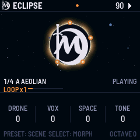

# Penumbra

**A space-drone instrument for the M-VAVE FM-1**, by Lunar Eclipse Forge.

Switch it on and a deep drone swells in, five slowly beating voices held on a pedal. You play over it:

- **VOX** is a soft synth voice that sits far back in a long shimmer reverb.
- **BLOOM** is a slow swell in the key.
- **The looper** follows the scene's key.
- **The holds** let you play the sound itself, with throws, bends and freeze.
- **MORPH** walks from one place to the next by hand.

The sound it reaches for is the cinematic drone of the ELTA Solar 42: thick, slow, and full of space. The
silence between the notes is part of it.

Version 1.0 · identity `FM-1_73010000` · GPL-3.0

**[Play it in the browser](https://madmooneyham.github.io/Penumbra/emu/)** (the same code the FM-1 runs) ·
**[Cheat sheet](https://madmooneyham.github.io/Penumbra/cheatsheet/)** (one printable page)

## Install

- **The easy way:** install it in one click from [The Firmware Hub](https://thefirmwarehub.com/).
- **In the browser:** the [web installer](https://madmooneyham.github.io/Penumbra/install/) writes it over USB
  (Chrome or Edge).
- **By hand:** download `penumbra-1.0.fwsc` from this repository's
  [Releases](https://github.com/MadMooneyham/Penumbra/releases), and write it with an FM-1 firmware installer.

Penumbra carries the update loader, so you can always go back to another firmware or to M-VAVE's own. If an
install ever won't start, hold **OCT-** and **OCT+** for five seconds to put the FM-1 in update mode.

## Two minutes in

1. **Switch it on.** The clock starts and the drone swells in.
2. **Play the white keys.** VOX plays in the scene's key, so every note fits. Leave space between them.
3. **Press black key 7** for a BLOOM, and black keys 8-11 to change VOX's sound.
4. **Press REC, play a phrase, then press REC again.** It loops. Press REC once more to layer over it.
5. **Turn PRESET** to move to the next scene: everything glides there, and the loop follows the key.
6. **Hold FX and turn K1** to throw the shimmer. Let go and it drifts back.
7. **Hold a white key and turn ALGO** to bend the note's pitch.

Everything else, from the drone voices to the looper, holds, scenes and sound pages, is in the
**[manual](MANUAL.md)**. Its last section is a one-page cheat sheet.

## What's in it

- **DRONE**: five voices on black keys 1-5, each held or coming and going, with a SWARM that thickens them.
- **VOX**: a four-voice synth on the white keys. It has four sounds (GLASS, REED, HALO, LOW), a wave from saw
  to a narrow pulse, a filter from low-pass to band-pass, and glide.
- **PULSE**: a deep kick tuned to the key, and BLOOM.
- **TEXTURE**: a bed of space wind, always under the rest.
- **Effects**: a shimmer reverb, a worn tape delay, and a master stage.
- **Journeys**: six preset banks of scenes, and eight user slots. The journey playing, with its loop, survives
  a power cut.
- **Extras**: MIDI clock in and out, VOX over MIDI (with pitch bend), USB audio, a SLEEP timer, and
  screen-reader support.

## For developers

Penumbra is written in C for the FM-1's JieLi AC791N. Its audio engine runs on both cores, and the whole app
also runs on a desktop simulator for testing.

- **Building:** BUILDING.md covers the toolchain, `./build.sh --release X.Y`, and the web installer.
  - Release builds are `FM-1_73XXYYZZ`; development builds are `FM-1_730`.
- **Tests:** `tests/run_tests.sh` runs the unit tests, the simulator's scenarios (`tests/scenarios/*.pen`)
  and the click checks.
- **Where things are:**
  - `firmware/src/dsp/`: the voices;
  - `firmware/src/seq/`: the journeys and the looper;
  - `firmware/src/app/`: the engine, the UI and the settings;
  - `host/`: the simulator.
- **Licence:** GPL-3.0-only. Penumbra is built on [Felucca](https://github.com/hugelton/Felucca) (Leo
  Kuroshita, Hügelton Instruments) and [X0X](https://github.com/charlesvestal/fm1-x0x) (Charles Vestal). The
  full credits are in LICENSING.md.

M-VAVE and FM-1 are trademarks of their owners.
